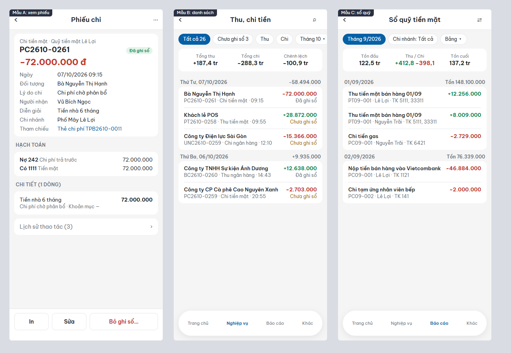

# Tư vấn giao diện điện thoại (T223, T224)

Lập ngày 14/10/2026. Đọc file này trước khi sửa màn chứng từ, danh sách, sổ trên điện thoại.

## Kết luận

Không cần làm lại giao diện điện thoại từ đầu. Khung theo IVT (4 tab, thẻ trắng, tấm chọn từ đáy) dùng tốt cho kế toán, giữ nguyên.

Cần một đợt chỉnh gồm hai phần:

1. Bổ sung 10 nhóm thông tin chứng từ mà bản web có, điện thoại chưa có. Nặng nhất là tài khoản Nợ, Có của phiếu thu, chi, thông tin hoá đơn, tình trạng thanh toán.
2. Sửa 8 điểm thiết kế để đọc số tiền nhanh hơn và khó bấm nhầm hơn.

Màu và phông giữ nguyên biến trong `:root`. Chỉ thêm luật dùng màu cho số tiền (mục 2.1).

## 1. Thông tin chứng từ (T223)

Cách rà: script mở 45 phiếu của 35 màn chứng từ, gói Plus và gói Pro. Mỗi phiếu đọc nhãn trường ở bản điện thoại 390px và bản máy tính 1440px rồi so với nhau. Chưa rà màn lập phiếu, mới rà màn xem phiếu và thẻ danh sách.

Điện thoại đã đủ các thông tin: thời gian, đối tượng, chi nhánh, diễn giải, nguồn, dòng hàng (số lượng, đơn giá, giảm giá, VAT, thành tiền), tổng, lịch sử thao tác, tham chiếu điều chuyển và kiểm kê.

| # | Thông tin | Bản web | Điện thoại | Màn |
|---|---|---|---|---|
| 1 | Tài khoản Nợ, Có | Nút **Cột tài khoản** trên dòng chi tiết | Không có khối Hạch toán | 2.1.1 (thu, chi, báo có, uỷ nhiệm chi, chuyển quỹ), 2.1.2 |
| 2 | Khối Hạch toán | Tab riêng | Có nhưng thu gọn, phải bấm mới thấy | Mọi phiếu còn lại |
| 3 | Quỹ, lý do thu chi, người giao dịch | Đầu phiếu | Thiếu | 2.1.1 |
| 4 | Mẫu số, ký hiệu, số hoá đơn, ngày hoá đơn | Đầu phiếu hoặc tab Hoá đơn | Thiếu | 3.1.2, 3.1.3, 3.1.4, 4.1.1 đến 4.1.6, 6.1.1, 6.1.2 |
| 5 | Tình trạng thanh toán (chưa thanh toán, tiền mặt ngay, chuyển khoản ngay, đã thu bao nhiêu) | Đầu phiếu, cột TT thu tiền, TT thanh toán, Xuất hoá đơn ở danh sách | Thiếu ở cả xem phiếu và thẻ danh sách | 3.1.x, 4.1.x |
| 6 | Kho | Ô Kho xuất, Kho nhập ở đầu phiếu, cột Kho từng dòng | Thiếu | 3.1.2, 3.1.7, 4.1.1, 4.1.2, 4.1.4, 5.1.1, 5.1.2 đến 5.1.2-4, 5.1.11 |
| 7 | Mã số thuế, hạn thanh toán | Đầu phiếu (hạn thanh toán ẩn ở gói Free, Standard theo QD56) | Thiếu | Bán hàng, mua hàng |
| 8 | Khoản mục, công việc | Cột trên dòng chi tiết | Thiếu | 2.1.1, 4.1.5, 4.1.6, 6.1.x, 8.1.x, 10.1.1 |
| 9 | Tham chiếu thẻ chi phí | Dòng "Thẻ chi phí: TPB2610-0011" | Thiếu | 2.1.1 |
| 10 | Cột Loại ở kiểm kê | Có | Thiếu | 5.1.10 |

Ba chỗ điện thoại hiện sai:

- Dòng chi tiết dạng diễn giải bị vẽ thành "Danh sách hàng hoá" kèm số lượng, đơn giá. Gặp ở 4.1.5, 4.1.6, 6.1.1, 6.1.2, 7.1.2, 8.1.2, 8.1.3, 10.1.1. Bản web các màn này không có cột số lượng.
- Phiếu thu, chi ghi "Thành tiền mặt hàng" ở khối tổng. Phiếu thu, chi không có mặt hàng.
- Thẻ danh sách Chuyển kho ghi "0 đ", thẻ Kiểm kê ghi 11.274.000 đ. Danh sách web của hai màn này không có cột Tổng tiền.

Một lỗi ở bản web: bật **Cột tài khoản** ở phiếu chi PC2610-0250 thì cột TK tiền mặt và TK Có đều ra "—". Dữ liệu giả của dòng thu chi chưa có tài khoản. Muốn mục 1 hiện số thật thì phải bổ sung dữ liệu này trước.

## 2. Thiết kế (T224)

Ảnh hiện tại: `docs/tu-van-anh/truoc-1.png` (trang chủ, Nghiệp vụ, danh sách thu chi, xem phiếu chi), `docs/tu-van-anh/truoc-2.png` (hoá đơn bán hàng, sổ quỹ, Báo cáo, Khác). Ảnh mẫu sau khi sửa: `docs/tu-van-anh/sau-3-man.png`. Số tổng trong ảnh mẫu B, C là số minh hoạ, tài khoản 242 ở mẫu A là giả định.

### 2.1. Số tiền có hướng

Hiện tại số tiền ở danh sách thu chi đều màu đen, ở xem phiếu màu cam. Nhìn danh sách không phân biệt được phiếu thu với phiếu chi nếu không đọc dòng loại phiếu. Màu cam còn trùng với chip "Chưa ghi sổ" và nút **Ghi sổ**.

Đề xuất: tiền vào ghi dấu `+` màu `--green`, tiền ra ghi dấu `−` màu `--red`, áp ở danh sách, sổ, đầu xem phiếu. Cam chỉ dùng cho trạng thái chờ và nút chính. Số tiền dùng `font-variant-numeric: tabular-nums` để các cột số thẳng hàng. Hiện chưa lớp `m-*` nào dùng thuộc tính này.

### 2.2. Tổng ở danh sách

Dòng "26 chứng từ · 475.703.000 đ" ở danh sách thu chi đang cộng chung tiền thu với tiền chi. Con số này không có nghĩa kế toán. Đề xuất thay bằng ba ô Tổng thu, Tổng chi, Chênh lệch (mẫu B). Các danh sách chỉ có một chiều tiền (bán hàng, mua hàng) giữ một tổng như hiện nay.

### 2.3. Danh sách nhóm theo ngày

Đề xuất mỗi ngày một tiêu đề (thứ, ngày) kèm tổng của ngày, các phiếu trong ngày nằm trong một thẻ. Mỗi phiếu 2 dòng: đối tượng và số tiền ở dòng trên; số phiếu, loại, giờ và trạng thái ở dòng dưới. Hiện mỗi phiếu chiếm khoảng 108px chiều cao, mẫu B còn khoảng 55px, một màn xem được gấp đôi số phiếu.

### 2.4. Xem phiếu

- Đặt số tiền lớn ngay dưới số phiếu. Hiện tổng chỉ nằm ở thanh đáy.
- Mở sẵn khối Hạch toán dạng gọn: mỗi bút toán một dòng "Nợ 242 Chi phí trả trước 72.000.000". Kế toán trưởng mở phiếu là để xem dòng này.
- Dòng hàng gọn thành 2 dòng: tên hàng và thành tiền; số lượng × đơn giá, VAT ở dòng phụ. Hiện mỗi mặt hàng là một thẻ cao khoảng 210px, hoá đơn 5 mặt hàng phải cuộn khoảng 1.050px.

### 2.5. Đáy màn xem phiếu

Màn xem phiếu có thanh thao tác và thanh 4 tab nổi chồng nhau ở đáy, chiếm khoảng 162px trên 844px (19%). Đề xuất ẩn thanh 4 tab ở màn cấp 2 (xem phiếu, lập phiếu, xem báo cáo), nút quay lại ở góc trái đã đủ để thoát.

### 2.6. Chống bấm nhầm

Phiếu đã ghi sổ hiện nút cam lớn **Bỏ ghi sổ** ở vị trí nút chính. Bấm một lần là bỏ ghi sổ ngay, không có hộp xác nhận (`MXemPhieu.tsx` dòng 141). Bỏ ghi sổ là thao tác đảo, làm đổi số liệu sổ sách. Đề xuất: phiếu đã ghi sổ thì nút chính là **In**; **Bỏ ghi sổ** chuyển thành nút viền chữ đỏ hoặc vào menu ⋯, bấm thì hỏi lại như khi xoá phiếu.

### 2.7. Sổ ở 390px

Sổ quỹ dạng bảng xếp cột Ngày, Số phiếu thu, Số phiếu chi trước. Ba cột cần đọc nhất là Thu, Chi, Tồn nằm ngoài màn, phải cuộn ngang mới thấy. Dòng "Số tồn đầu kỳ" trông như dòng trống vì chữ nằm ở cột Diễn giải bị khuất.

Đề xuất sổ quỹ, sổ tiền gửi, sổ chi tiết công nợ có thêm kiểu xem dạng dòng (mẫu C): đầu sổ có Tồn đầu, Thu, Chi, Tồn cuối; nhóm theo ngày, tiêu đề ngày ghi số tồn cuối ngày; mỗi dòng có diễn giải, số phiếu, chi nhánh, tài khoản đối ứng và số tiền có dấu. Kiểu bảng giữ lại, chuyển bằng chip **Bảng**.

### 2.8. Chip chi nhánh ở thanh trên

Chip "Tất cả" chọn chi nhánh hiện ở mọi màn, kể cả xem phiếu đã ghi rõ chi nhánh của phiếu. Đề xuất chỉ hiện chip ở danh sách, báo cáo, trang chủ.

## 3. Thứ tự làm đề xuất

| Đợt | Việc | Ai làm |
|---|---|---|
| 1 | Mục 1.1 đến 1.10 và ba chỗ hiện sai; bổ sung tài khoản cho dữ liệu giả thu chi | Anti A |
| 1 | 2.6 chống bấm nhầm, 2.5 ẩn thanh tab ở màn cấp 2 | Anti B |
| 2 | 2.1, 2.2, 2.3 danh sách và màu số tiền | Anti B |
| 2 | 2.4 xem phiếu, 2.7 sổ dạng dòng, 2.8 chip chi nhánh | Anti A |

Claude kiểm từng đợt bằng ảnh 390px và `kiem_tra.py --dien-thoai` trước khi push.
